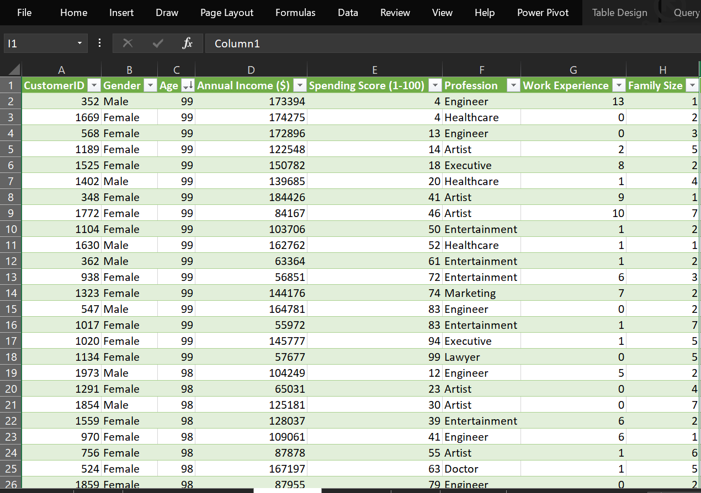

# Customer Segmentation and Spending Behaviour Analysis

**An Excel Analytics Portfolio Project by Okunola Ayobami**


---

## Project Overview

**How can a retailer identify valuable customers and target campaigns more effectively?**

For this project, I analysed **2,000 customer records** to explore demographics, compare spending patterns, and build rule-based customer segments.

I used Microsoft Excel to prepare the data, create calculated columns and DAX measures, and develop a **three-page interactive dashboard**.

###  Main Finding

Annual income and spending score have almost no linear relationship in this dataset.

**Correlation coefficient: 0.02**

This suggests that annual income alone is a weak basis for identifying high-spending customers.

---

##  Business Problem

The project scenario involves a retailer with membership data but limited insight into its customer base.

The analysis aims to support:

- More focused marketing campaigns
- Personalised customer offers
- Improved customer segmentation
- Better customer retention decisions
- Data-driven business strategies

### Key Business Questions

1. Who are the customers by age, gender, profession, and income?
2. How do spending patterns differ across customer groups?
3. Is annual income associated with spending score?
4. Which customers qualify as high value under the segmentation rules?
5. How can the findings inform marketing decisions?

---

## Dataset

**Dataset Name:** Shop Customer Data  
**Source:** Kaggle  
**Total Records:** 2,000  
**Original Columns:** 8

The exact dataset URL and redistribution licence are not specified in the supplied project materials.

### Dataset Description

| Field | Description |
|---|---|
| CustomerID | Customer identifier |
| Gender | Recorded customer gender |
| Age | Recorded age in years |
| Annual Income ($) | Annual income in dollars |
| Spending Score (1-100) | Store-assigned spending score |
| Profession | Customer profession |
| Work Experience | Years of work experience |
| Family Size | Number of family members |



---

##  Tools and Technologies

The following tools were used throughout the project:

| Tool | Purpose |
|---|---|
| Microsoft Excel | Data analysis and dashboard development |
| Power Query | Data cleaning and transformation |
| Power Pivot | Data modelling |
| DAX | KPI and analytical measures |
| PivotTables | Data aggregation and exploratory analysis |
| Slicers | Interactive dashboard filtering |
| Microsoft PowerPoint | Dashboard layout design |

---

##  Project Workflow

The analysis followed five major stages.

### 1. Data Preparation

Using Excel and Power Query, I reviewed:

- Column data types
- Missing values
- Duplicate customer identifiers
- Unusual numerical values
- Data consistency

### 2. Feature Engineering

I developed **11 calculated columns** to support:

- Age grouping
- Income classification
- Spending-score classification
- Work-experience grouping
- Customer segmentation

### 3. KPI Development

I created **eight DAX measures** in Power Pivot using functions including:

- `AVERAGE()`
- `CALCULATE()`
- Counting functions

These measures were used to summarise customer characteristics and segment performance.

### 4. Exploratory Data Analysis

I developed **15 PivotTable insight tables** to analyse customer demographics, income, and spending patterns.

I also calculated the correlation between annual income and spending score.

### 5. Dashboard Development

I designed the dashboard layout in PowerPoint and assembled the final interactive dashboard in Excel.

The dashboard includes:

- Three analytical pages
- Interactive slicers
- KPI summaries
- Data visualisations
- Navigation buttons

---

##  Data Cleaning and Quality Decisions

The following issues were identified during data preparation.

| Data Quality Issue | Records | Treatment |
|---|---:|---|
| Missing profession | 35 | Replaced with the most frequent profession, Artist |
| Ages below 18 | 332 | Retained and labelled Invalid in the life-stage grouping |
| Zero annual income | 2 | Retained in the Extremely Low income category |
| Duplicate CustomerIDs | 0 | No duplicate removal required |

### Important Data Quality Notes

The profession imputation increased the number of customers classified as Artists from **612 to 647**.

Customers below age 18 were labelled Invalid only under the project's adult-customer assumption. Being younger than 18 is not inherently an invalid age.

These records were retained in the overall analysis, including reported totals and averages.

---

##  Key Performance Indicators

The dashboard presents the following KPIs.

| KPI | Result | Interpretation |
|---|---:|---|
| Total Customers | 2,000 | Total customer records |
| Average Age | 49 years | Rounded from 48.96 |
| Average Annual Income | $110,732 | Mean recorded income |
| Average Spending Score | 51 | Rounded from 50.96 |
| Score-to-Income Ratio | 0.05% | Average spending score divided by average income |
| Average Work Experience | 4 years | Rounded from 4.10 |
| High Flag Customers | 1,112 | Customers classified High under Customer_Class |
| High-Value Customers | 758 | Customers classified High under Customer Segment |

> **Note:** Spending score is an index rather than a monetary value. Therefore, the reported 0.05% score-to-income ratio does not represent the percentage of income spent.

---

##  Customer Segmentation Methodology

This project uses **rule-based customer segmentation**, not machine-learning clustering.

Customers were classified using predefined income and spending-score thresholds.

### 1. Customer Segment

The Customer Segment classification combines annual income and spending-score thresholds.

| Annual Income | Low Value | Medium Value | High Value |
|---|---|---|---|
| Up to $37,994 | Score ≤ 40 | Score 41–60 | Score 61–100 |
| Above $37,994 | Score ≤ 20 | Score 21–60 | Score 61–100 |

### Customer Segment Distribution

| Segment | Customers | Percentage |
|---|---:|---:|
| High | 758 | 37.90% |
| Medium | 863 | 43.15% |
| Low | 379 | 18.95% |
| **Total** | **2,000** | **100.00%** |

**Interpretation:**

- 37.9% of customers fall into the High-value segment.
- 43.15% belong to the Medium-value segment.
- 18.95% belong to the Low-value segment.

In this project, High value means a spending score of at least 61. It does not establish actual profitability or customer lifetime value.

### 2. Customer_Class

Customer_Class is a separate classification system.

| Customer Class | Customers |
|---|---:|
| High | 1,112 |
| Medium | 625 |
| Low | 263 |
| **Total** | **2,000** |

The Customer_Class rules classify customers in the lowest and highest income bands as High regardless of spending score.

Therefore, Customer_Class should not be confused with Customer Segment.

### 3. Purchasing Status

Purchasing Status combines:

- Five annual income bands
- Five spending-score bands

The resulting 25 combinations produce **24 distinct customer persona names**, because Moderate Buyer appears in two combinations.

The High spending-score group uses a threshold of **67–100**, which differs from the High-value Customer Segment threshold.

---

##  Dashboard Preview

The Excel dashboard contains three interactive analytical pages.

It includes Customer_Class and Purchasing Status slicers, alongside navigation buttons.

### Dashboard 1: Customer Distribution

This dashboard explores the distribution of customers across:

- Age
- Gender
- Profession
- Customer class
- Customer segment

<!-- Insert Customer Distribution dashboard screenshot here -->

### Dashboard 2: Spending Behaviour

This dashboard compares spending-score groups across:

- Profession
- Gender
- Age
- Work experience
- Family size

<!-- Insert Spending Behaviour dashboard screenshot here -->

### Dashboard 3: Income and Spending

This dashboard explores:

- Income distribution
- Average income by profession
- Spending patterns across income bands
- Income and spending relationships

<!-- Insert Income and Spending dashboard screenshot here -->

---

##  Key Findings and Insights

### 1. Annual Income Is a Weak Predictor of Spending Score

The reported correlation between annual income and spending score is:

**r = 0.02**

This indicates almost no linear association between the two variables in the dataset.

**Business implication:**

Marketing decisions should not rely exclusively on customer income.

Combining income with spending behaviour and customer segmentation may provide a more useful targeting approach.

However, the correlation does not establish causation or exclude every possible nonlinear relationship.

### 2. High-Value Customers Exist Across Different Income Groups

A total of **758 customers (37.9%)** qualify as high value.

Their distribution across income groups is shown below.

| Income Group | High-Value Customers | Share of High-Value Customers |
|---|---:|---:|
| Lower-Middle | 253 | 33.4% |
| High | 229 | 30.2% |
| Upper-Middle | 226 | 29.8% |
| Low | 50 | 6.6% |

**Key insight:**

The Lower-Middle income group contributes the largest number of high-value customers.

This demonstrates why customer targeting should not focus exclusively on the highest-income customers.

However, these are customer counts, not within-group high-value rates.

### 3. Female Customers Represent the Larger Customer Group

The dataset contains:

| Gender | Customers | Percentage |
|---|---:|---:|
| Female | 1,186 | 59.3% |
| Male | 814 | 40.7% |
| **Total** | **2,000** | **100.0%** |

Female customers represent the majority of the dataset.

**Business implication:**

Customer group sizes should be considered when evaluating campaign reach and comparing spending counts.

### 4. Artists Represent the Largest Profession Group

Artists account for:

- **647 customers**
- **32.35% of the dataset**
- **224 customers in the High spending-score group**

This makes Artist the largest recorded profession category.

**Important limitation:**

The Artist count includes 35 records whose missing profession values were replaced using mode imputation.

Therefore, the profession distribution is partly influenced by the cleaning method.

### 5. Customer Personas Provide Additional Marketing Insights

The Purchasing Status classification identifies several customer personas.

Notable findings include:

| Persona | Customers | Description |
|---|---:|---|
| Balanced Buyer | 138 | Largest individual persona |
| Elite Buyer | 89 | Highest income and spending-score bands |
| Moderate Buyer | 123 | Combined total across two classification combinations |

These personas provide additional detail for designing targeted marketing campaigns.

---

##  Business Recommendations

Based on the analysis, the following actions are recommended.

| Recommendation | Supporting Evidence | Evaluation Metric |
|---|---|---|
| Use Customer Segment and Purchasing Status for targeted campaigns | Income–spending correlation is 0.02 | Campaign conversion rate |
| Pilot personalised offers for high-value customers | 758 customers meet the High-value rule | Repeat purchases and incremental sales |
| Include Lower-Middle income customers in marketing campaigns | 253 high-value customers belong to this group | Response rates and acquisition costs |
| Test loyalty benefits for relevant buyer personas | Personas distinguish income and spending combinations | Customer retention and offer redemption |
| Regularly evaluate campaign effectiveness | Segmentation enables testable targeting decisions | Controlled campaign comparisons |

### Expected Business Applications

The analysis can support:

- Customer targeting
- Personalised promotional campaigns
- Customer loyalty planning
- Marketing resource allocation
- Customer retention strategies

> **Important:** These are proposed business recommendations. The project does not contain actual campaign results or measured revenue improvements.

---

##  Project Limitations

Several limitations should be considered when interpreting the findings.

1. **Dataset availability:** The workbook and raw dataset are not included in the current repository package, preventing independent recalculation of the results.

2. **Age validation:** The dataset contains 332 records below age 18 that were flagged under the project's adult-customer assumption.

3. **Profession imputation:** Replacing missing professions with Artist may overstate the size of that category.

4. **Spending-score interpretation:** The calculation behind the spending score is not documented. The score cannot replace actual revenue, margin, purchase frequency, or customer lifetime value.

5. **Score-to-income ratio:** This metric combines incompatible units and should be replaced with a more interpretable measure.

6. **Customer_Class rules:** Extreme income bands are automatically classified High, making the classification unsuitable for operational targeting without further review.

7. **DAX documentation:** The original DAX expressions were not supplied, so reconstructed formulas are not presented as the original implementation.

8. **Dataset licensing:** The original dataset URL and redistribution licence should be confirmed before uploading the raw data.

---

##  Future Improvements

Future versions of this project could include:

- Validation and refinement of customer segmentation rules
- Additional transaction-level data
- Revenue-based customer value metrics
- Customer lifetime value analysis
- Alternative approaches to handling missing profession values
- Improved dashboard metrics
- Campaign performance tracking
- Comparison of campaign outcomes across customer segments

These improvements would help connect descriptive customer segmentation to measurable business performance.

---

##  Repository Structure

```text
Customer-Segmentation-Analysis/
│
├── README.md
│
├── assets/
│   ├── dashboard-screenshots/
│   ├── kpi-summary/
│   └── recommendations/
│
└── reports/
    └── customer-segmentation-report.pdf
```

### Repository Contents

| File / Folder | Description |
|---|---|
| `README.md` | Project documentation, methodology, findings, and recommendations |
| `assets/` | Dashboard screenshots, KPI summary, and recommendations |
| `reports/customer-segmentation-report.pdf` | Detailed original project report |

 [**Read the Full Project Report**](reports/customer-segmentation-report.pdf)

> The repository structure above represents the intended organisation. Referenced screenshots and the PDF report must be uploaded to their respective folders for the links and previews to work.

---

##  Skills Demonstrated

Through this project, I demonstrated practical skills in:

- Microsoft Excel
- Data cleaning and transformation
- Power Query
- Feature engineering and calculated columns
- Power Pivot
- DAX measures
- PivotTables
- Exploratory data analysis
- Customer segmentation
- Dashboard design
- Data visualisation
- Business insight generation
- Analytical reporting
- Data-driven recommendations

---

##  Author

**Okunola Ayobami**

**Project:** Customer Segmentation and Spending Behaviour Analysis

**Project Type:** Excel Data Analytics Portfolio Project

**Date:** October 2026

**Learning Platform:** Cipher Tech

---

###  Project Summary

This project demonstrates how Microsoft Excel, Power Query, Power Pivot, DAX, and interactive dashboards can be used to analyse customer data and develop actionable business recommendations.

By examining 2,000 customer records, the analysis identified meaningful customer segments, highlighted differences in spending behaviour, and demonstrated that annual income alone is a weak indicator of spending score.

The project illustrates how descriptive analytics and rule-based segmentation can support more informed marketing and customer management decisions.

---

**If you found this project useful, consider giving the repository a star! **
